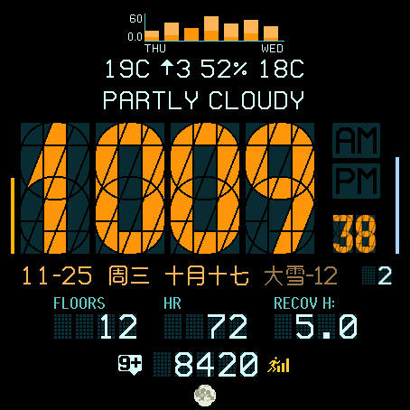
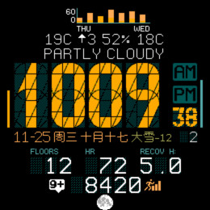
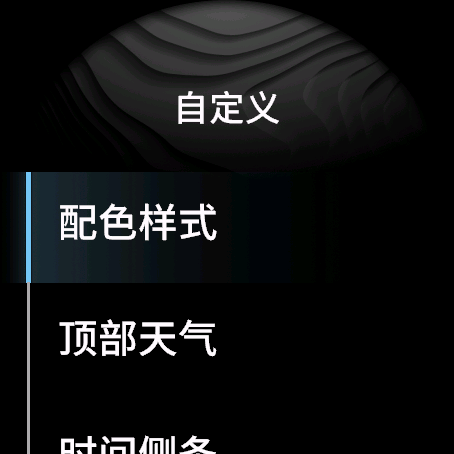
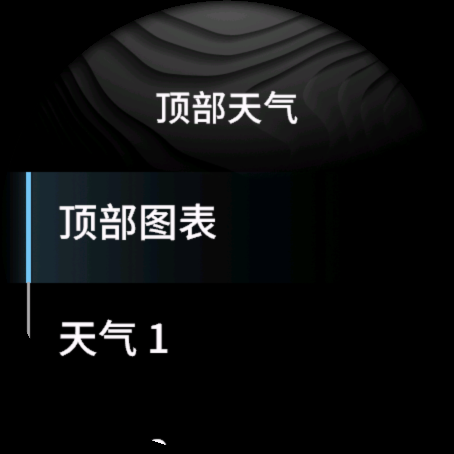
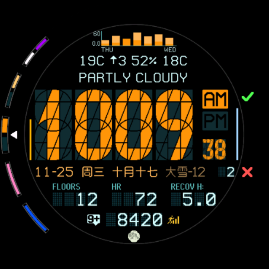
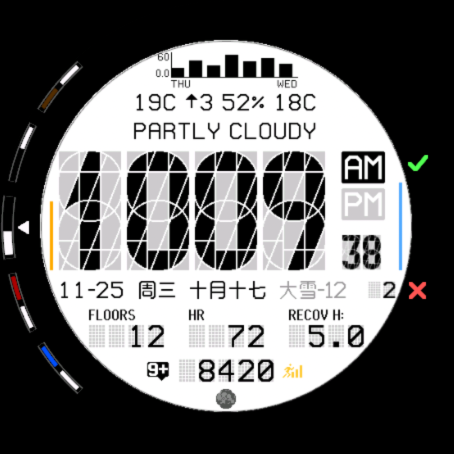

# Seg34-C11

<!-- Buy Me a Coffee: reserve the link here. -->

[中文主页](https://dass-s-c.github.io/Seg34-C11/) · [English Site](https://dass-s-c.github.io/Seg34-C11/en.html) · [English README](#english)

Seg34-C11 是 **dass** 基于开源表盘 [Segment34 Mk3](https://github.com/ludw/segment34mk3) 制作的中文改版，面向 Garmin AMOLED 手表。AMOLED 版正准备在 Connect IQ 商店首发。

表盘中央用大号数码字显示时分，下方用专绘中文点阵字显示星期、农历日期和节气倒计时。可以直接在手表上调整布局、预览配色。

## 表盘预览

<table>
  <tr>
    <td align="center">
       
      <b>fēnix 9 Pro · 47 mm</b> AMOLED · 454 × 454 · 24 px 点阵字 AMOLED 版准备首发上架
    </td>
    <td align="center">
       
      <b>fēnix 9 Pro Solar · 47 mm</b> MIP · 260 × 260 · 15 px 点阵字 MIP 版尚未上架，后续会继续开发
    </td>
  </tr>
</table>

自上而下依次为近 7 天趋势图、两行天气、大号时分数字与两侧进度条、中文农历节气日期栏及下方运动数据。点击表盘查看大图。

## 主要特点

- **天气独享两行，保留英文留白**：顶部为近 7 天活动趋势图，下方第一行可自定义 4 项天气指标（如温度、风力、湿度、体感温度或降水概率），第二行专留给英文天气状况（如 `PARTLY CLOUDY`），不与日历挤在一起。
- **农历日期与节气倒计时**：时间下方显示月日、星期和农历日期。节气倒计时用淡色显示，节气当天恢复正常亮度。星期可选中文、英文或隐藏。
- **秒数移入主时间旁，释放行末状态位**：两位秒数排在主时间右侧，日期行末腾出一个独立状态位——默认显示久坐等级，也可切为压力、身体电量、恢复时间或通知数，与主时间左右两侧的进度条彼此独立。
- **专绘 Seg34 Block-Round 中文点阵字**：围绕星期、农历与节气用到的 45 个汉字逐字绘制，分为 **24 px**（主流 AMOLED）与 **15 px**（360×360 AMOLED 及后续 MIP）两套纯 1-bit 点阵字，小屏下笔画清晰且与主时间的数码字风格一致。
- **更清晰的底栏与图标**：AMOLED 机型采用加粗底栏标题，底部数字支持 `点阵`、`混合`、`线条` 三种样式；电池、月相、像素通知气泡与中英文训练状态图标均针对小屏重新微调。

   
  <b>Seg34 Block-Round 中文点阵字</b>：上排 24 px（主流 AMOLED）· 下排 15 px（360×360 AMOLED / MIP，MIP 版尚未上架）

## 手表端分区设置与配色预览

常用调整直接做进手表原生菜单，按表盘自上而下的位置分成 5 组——`配色样式`、`顶部天气`、`时间侧条`、`日期栏`、`下方数据`——看见哪一栏想换就进哪一组；选择日间或夜间配色时，手表直接实时预览整张表盘效果，确认后再应用。同时也完整支持 Garmin Connect 手机端配置。

<table>
  <tr>
    <td align="center">
       
      <b>自定义主菜单</b> 按表盘位置分 5 组
    </td>
    <td align="center">
       
      <b>顶部天气分组</b> 直接调整图表与天气栏
    </td>
    <td align="center">
       
      <b>深色配色预览</b> 深青色底／橙色
    </td>
    <td align="center">
       
      <b>浅色配色预览</b> 白底／黑色
    </td>
  </tr>
</table>

左两张为手表端分区设置菜单；右两张为整盘实时配色预览，左侧沿表圈切换配色，右侧确认或取消。

## 支持机型 / Supported models

AMOLED 版正准备首发上架 Connect IQ 商店，覆盖 51 个 AMOLED SDK 设备目标（360×360 机型使用 15 px 点阵字，其余发布目标使用 24 px；具体可安装型号以上架后商店设备列表为准）。以下按系列汇总：

The AMOLED edition is preparing for its Connect IQ Store launch, covering 51 AMOLED SDK device targets (360×360 models use the 15 px glyphs; other release targets use 24 px; check the store’s compatible device list once live). Models grouped by series:

| 系列 / Series | 机型 / Models |
| --- | --- |
| fēnix | fēnix 8 AMOLED（43 / 47 / 51 mm）、fēnix 9（43 / 47 / 51 mm）、fēnix 9 Pro AMOLED（43 / 47 / 51 mm）、fēnix E |
| Forerunner | 70、165 / 165 Music、170 / 170 Music、265 / 265S、570（42 / 47 mm）、965、970 |
| Venu / vívoactive | Venu 2 / 2S / 2 Plus、3 / 3S、4（41 / 45 mm）、X1，vívoactive 5 / 6 |
| epix / MARQ | epix Gen 2、epix Pro Gen 2（42 / 47 / 51 mm）、MARQ Gen 2（含 Aviator / including Aviator）、MARQ Gen 3 |
| Instinct | Instinct 3 AMOLED（45 / 50 mm）、Instinct Crossover AMOLED |
| Approach / Descent | Approach S50、S70（42 / 47 mm）、S72（43 / 47 mm），Descent G2、Mk3（43 mm）、Mk3i（43 / 51 mm） |
| D2 | D2 Air X10 / X15、D2 Mach 1 / 1 Pro、D2 Mach 2 / 2 Pro |
| tactix / quatix | tactix 7 AMOLED Edition、tactix 8 AMOLED（47 / 51 mm）、quatix 7 Sapphire / 7 Pro、quatix 8（47 / 51 mm） |

注：MIP 版（如 fēnix 9 Pro Solar 47 / 51 mm）尚未上架，后续会继续开发。

Note: The MIP edition (such as fēnix 9 Pro Solar 47 / 51 mm) is not yet released and remains in development.

## 反馈与资料

戴了一段时间后，欢迎在 [反馈区](https://github.com/dass-s-c/Seg34-C11/issues) 说说你用的机型、最常看哪一栏，或者哪处还想调整。遇到显示或设置问题，可以附上版本和截图。公开截图请裁去个人、位置和健康信息。

- [dass 的表盘项目](https://github.com/dass-s-c)
- [项目主页（中文）](https://dass-s-c.github.io/Seg34-C11/) · [Project site (English)](https://dass-s-c.github.io/Seg34-C11/en.html)
- [隐私说明 / Privacy](PRIVACY.md)
- [版权与第三方许可 / Copyright and notices](https://dass-s-c.github.io/Seg34-C11/notices/)（[NOTICES.txt](NOTICES.txt)）
- 上游项目：[Segment34 Mk3](https://github.com/ludw/segment34mk3)（MIT License） · 署名：`dass`

---

## English

Seg34-C11 is a Chinese edition of the open-source [Segment34 Mk3](https://github.com/ludw/segment34mk3) watch face, adapted by **dass** for Garmin AMOLED watches. The AMOLED edition is being prepared for its first Connect IQ Store release. The MIP edition shown above is still in development and has yet to be released.

Large digital numerals show the hours and minutes. The weekday, lunar date and solar-term countdown sit below. Adjust the layout and preview colors on the watch.

### Highlights

- **Two dedicated weather lines**: A 7-day trend graph sits at the top, followed by four customizable weather metrics (such as temperature, wind, humidity, feels-like, or precipitation chance) and a clean English condition line (`PARTLY CLOUDY`), never crowded by the calendar.
- **Lunar date and solar-term countdown**: The month, day, weekday and lunar date appear below the time. The solar-term countdown is dimmed until the day of the solar term, when it brightens. Show the weekday in Chinese or English, or hide it.
- **Side seconds & extra status slot**: Moves two-digit seconds beside the clock, opening an independent status slot at the end of the date line—defaulting to Move Bar level, or switchable to stress, Body Battery, recovery time, or notifications—separate from the two vertical side bars.
- **Original Seg34 Block-Round bitmap glyphs**: Drawn pixel by pixel for the 45 Chinese characters used across weekdays, lunar dates, and 24 solar terms in two pure 1-bit sizes—**24 px** for most AMOLED watches and **15 px** for 360×360 AMOLED models and the upcoming MIP edition (not yet released; further development planned).
- **Spatial on-watch settings & live palette preview**: Built-in Chinese menus mirror the dial top-to-bottom across 5 groups (`配色样式` Colors & Style, `顶部天气` Top Weather, `时间侧条` Time Side Bar, `日期栏` Date Bar, `下方数据` Lower Data). Choosing Day or Night palettes previews the entire dial live on the watch before applying.
- **Sharper lower dial & icons**: AMOLED models use bold lower labels with selectable `Dot`, `Hybrid`, or `Lines` numerals, larger battery and moon-phase icons, crisp pixel notification badges, and matched English/Chinese training status colors.

After wearing the face for a while, [tell us](https://github.com/dass-s-c/Seg34-C11/issues) which watch you use, which field you check most, or what you would change. For display or menu issues, include the version and crop personal, location and health information from any screenshot.

[Watch face projects by dass](https://github.com/dass-s-c) · [Project site](https://dass-s-c.github.io/Seg34-C11/en.html) · [中文主页](https://dass-s-c.github.io/Seg34-C11/) · [Privacy](PRIVACY.md) · [Copyright and notices](https://dass-s-c.github.io/Seg34-C11/notices/) · [Upstream Segment34 Mk3](https://github.com/ludw/segment34mk3)
